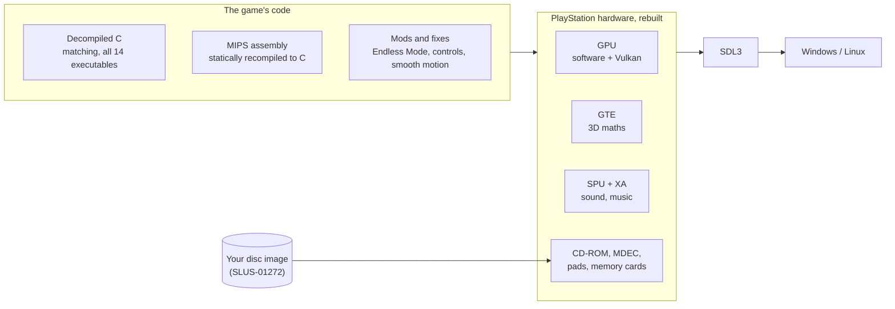

  

  
  
  
  

  <a href="../../releases/latest"><b>Download for Windows</b></a> &nbsp;·&nbsp;
  <a href="../../releases/latest"><b>Download for Linux</b></a> &nbsp;·&nbsp;
  <a href="#setup-in-3-steps"><b>Setup in 3 steps</b></a> &nbsp;·&nbsp;
  <a href="docs/DEVELOPMENT.md"><b>Developer guide</b></a>

  

**The 2000 PlayStation shooter, rebuilt to run natively on PC.** This isn't an emulator or your average decomp! The game's code was decompiled, rebuilt for the PC in the C language, and given a new "engine room": smooth motion at your monitor's refresh rate, sharp high-resolution graphics, mouse and keyboard or a modern gamepad layout, many new gameplay additions, and an entirely new Endless (high-score) Mode.

## Table of contents

- [PlayStation vs. PC](#playstation-vs-pc)
- [Features](#features)
- [Endless Mode](#endless-mode)
- [Bond's arsenal](#supplied-by-mi6s-finest-bonds-arsenal-of-weaponry-and-gadgets)
- [Grenades](#grenades)
- [Blackjack mode](#blackjack-mode)
- [Port settings](#port-settings)
- [Controls](#controls)
- [Debug menu](#debug-menu)
- [HD movies](#hd-movies)
- [What you need](#what-you-need)
- [Setup in 3 steps](#setup-in-3-steps)
- [FAQ](#faq)
- [Under the hood](#under-the-hood)
- [Known issues](#known-issues)
- [Roadmap](#roadmap)
- [Contributing](#contributing)
- [Acknowledgements](#acknowledgements)
- [Credits and legal](#credits-and-legal)

## PlayStation vs. PC
[(Back to top)](#table-of-contents)

  
   
  <i>PS1 vs. port comparison.</i>

  
   
  <i>The original's 512 × 240 picture with 15-bit colour, and the port at four times the resolution in true colour.</i>

## Features
[(Back to top)](#table-of-contents)

  
   
  <i>The game originally runs at 20 FPS. Smooth motion draws extra frames in between, so the picture moves at your display's refresh rate while keeping the original artistic vision intact.</i>

| | |
|---|---|
| **Smooth motion** | **"Shaken, not Stirred..."** The game engine technically still runs at its original 20 frames a second; the port draws the frames between ticks, at 60, 144 or 240 Hz: whatever your display runs at. |
| **High-resolution graphics** | Your GPU redraws the game at up to 8× the PlayStation's resolution, in true colour. Prefer the original look, with its 15-bit colour and dithering? See PORT SETTINGS. |
| **Mouse and keyboard** | Mouse look, with additional keyboard layout support, number keys for weapon groups, quick punch, quick grenade, sprint. |
| **Modern gamepad controls** | Gripping, modern controls for dynamic movement and gadget combos! Twin-stick aiming, triggers to aim and fire, and an all-new sprint. Supports any controller SDL recognises: Xbox, PlayStation, Switch and generic pads. |
| **Quick punch and quick grenade** | Quick controls for frag grenades and melee, removing the original's need to cycle through weapons or switch to unarmed. |
| **Save states** | F5 to save, F6 to load. |
| **The entire game** | Every mission, the menus, briefings, movies, music and memory card saves, from the PlayStation boot animation on. Nothing is cut, and extra effort went into restoring content cut from the retail and development versions. |

  
   
  <i>Quick punch: attack with "unarmed" in left hand without holstering weapon, or while reloading.</i>

## Endless Mode
[(Back to top)](#table-of-contents)

  

**BOND IS BACK!** with a new way to play. Pick **ENDLESS** on mission select and fight wave after wave through rooms taken from nine of the game's missions, from Courier's bank to Turncoat's subway. Each room picks its guards from that mission, sends them in through the doors, and opens an exit when you've fought for it. Your weapons, health and armour come with you, along with weapons lent from other missions. Your score goes on the game's own high-score table, saved to the memory card.

- **61 rooms**, hand-picked by playing every section of every mission. Some flow into each other: King's Ransom's streets and the Turncoat subway's cars.
- **AI/Room Director** paces the waves, sends guards in by doorways you can't see, and lets the room's own guards hunt you when it goes quiet.
- **Bond's arsenal, unleashed:** your inventory can hold any of the game's guns. The PS1 original didn't have the memory to do this in-engine.
- **Mission objectives, suppressed:** no timers, alarms or mission-failure screens, just the fight!
- **8 MB mode** (optional) raises the people limit from 6 to 12 at once.

### Scoring and medals

  
   
  <i>The run's stats on the Mission Complete screen, from a black medal up to gold.</i>

**Endless Mode** scores every run as you play:

| | Points |
|---|---|
| **A kill** | 100, doubled if it comes the moment you enter a room and falling back to 100 over the first minute, then multiplied by the wave: ×1.1 on wave 1, ×2 on wave 10, ×3 on wave 20 |
| **A room cleared** | 500 + 250 per wave, plus up to 900 more for clearing it in under 90 seconds |
| **At the end of the run** | 250 per headshot, plus 50 per point of accuracy (a 60% run: 3,000) |

The run ends when Bond falls, and its stats rate four lines out of four stars each:

- **Efficiency:** kills per hit landed. One hit per kill is 100%.
- **Accuracy:** hits per shot fired.
- **Waves:** 5% per wave reached, so wave 20 is 100%.
- **Time:** how long you survived, with 20 minutes for 100%.

Each line earns a star at 21%, 41%, 61% and 81%. The stars add up to the medal: **black** (0–5), **bronze** (6–10), **silver** (11–15) or **gold** (16–20), with Bond's gun on the screen in the medal's colour. On the harder difficulty every line earns one extra star. A ranked run's score goes on the high-score table on your memory card; cheats, save states, the debug menu and infinite grenades make a run unranked.

**The campaign** keeps the original game's own scoring and medals: 100 per kill, 1,000 per headshot, 1,000 per point of efficiency, up to 8,000 for the health you finish with, 25 for every second under the mission's par time, plus the mission's own bonuses. Its medals rate efficiency, accuracy, the health you finish with, and your time against the mission's par.

## Supplied by MI6's Finest: Bond's Arsenal of Weaponry and Gadgets
[(Back to top)](#table-of-contents)

<table>
  <tr>
    <td width="33%"></td>
    <td width="33%"></td>
    <td width="33%"></td>
  </tr>
  <tr>
    <td width="33%"></td>
    <td width="33%"></td>
    <td width="33%"></td>
  </tr>
  <tr>
    <td width="33%"></td>
    <td width="33%"></td>
    <td width="33%"></td>
  </tr>
  <tr>
    <td width="33%"></td>
    <td width="33%"></td>
    <td width="33%"></td>
  </tr>
  <tr>
    <td width="33%"></td>
    <td width="33%"></td>
    <td width="33%"></td>
  </tr>
</table>

<i>Fifteen of the game's weapons, each in a room of Endless Mode.</i>

Each weapon works the same in every Endless room as in its home mission: fire rate, damage, scope and sounds are all identical.

## Grenades
[(Back to top)](#table-of-contents)

<table>
  <tr>
    <td width="50%"></td>
    <td width="50%"></td>
  </tr>
</table>

**Quick grenade:** a frag grenade on its own button (G, or R1 on a gamepad), thrown without holstering your weapon, with a frag counter on the HUD. An optional **infinite grenades** setting is available in PORT SETTINGS.

## Blackjack mode
[(Back to top)](#table-of-contents)

  

**"Well played, Mr. Bond..."** The fan-favourite, PlayStation-exclusive casino from Russian Roulette, straight from the main menu: pick **BLACKJACK** and you're seated at the table.

## Port settings
[(Back to top)](#table-of-contents)

  

The port's options live inside the game's own **Options** menu: **PORT SETTINGS** has mouse speed, invert mouse, pad layout (modern or original), smooth motion, HD movies, vibration, enemy AI (the port's improved or the original), where the in-game message box sits (bottom or top), **CONTROLS** for remapping ([below](#remapping)) and the debug menu. Options also gets **AUTOLOAD**, the memory card slot loaded at start. Every setting is also a line in `twine.ini`, alongside the ones with no menu entry (display, renderer, scale, filter and more: see [docs/DEVELOPMENT.md](docs/DEVELOPMENT.md)).

## Controls
[(Back to top)](#table-of-contents)

Press **F1** in the game for the full list. Everything can be rebound ([below](#remapping)).

| Action | Keyboard and mouse | Gamepad |
|---|---|---|
| Move / look | WASD / mouse | left stick / right stick |
| Fire / aim | left button / right button | R2 (RT) / L2 (LT) |
| Use | E or F | Triangle (Y) |
| Reload | R | Square (X) |
| Change weapon | 1-9 by group, wheel or Z/X; Q for the previously used weapon | d-pad left/right; L1 (LB) for the previously used weapon |
| Punch / grenade | Space or mouse 4 / G | R3 / R1 (RB) |
| Sprint / crouch | Shift / C or Ctrl | L3 (toggle) / Circle (B) |
| Messages | Tab | Back or touchpad |
| Pause | Esc or Enter | Start |
| Save / load state | F5 / F6 | |
| Full screen | F11 or Alt+Enter | |

### Remapping

Every action can be rebound, on the keyboard, mouse and gamepad:

- **In the game:** Options → PORT SETTINGS → **CONTROLS**. Pick an action and press the new key or button. Right adds a second one, Left puts the row back, and the last row resets everything. Changes are saved straight away.
- **In `twine.ini`:** a `[controls]` block lists every action with its current keys, for example `fire = Mouse Left` or `use = E, F`. Remove the `#` in front of a line to change it. Keys are named the way your keyboard labels them, and gamepad buttons by position (South, East, Right Trigger...).

F1 in-game shows your current bindings. Prefer the PlayStation's own button layouts? Set **PAD LAYOUT** to ORIGINAL in PORT SETTINGS, and the game's Options → **CONTROLLER** page chooses the gamepad's buttons, as on the original console version.

 

## Debug menu
[(Back to top)](#table-of-contents)

  

The original developers' debug menu, left in the game's code, with pages restored from a development version. Open it with **F9**; **DEBUG MENU** must be enabled in PORT SETTINGS first.

| Option | What it does |
|---|---|
| **DISPLAY** | An information panel: (player info, first-person weapon info, object counts, frame rate (shown frames added) and more), plus three pages from a 2000 beta that the retail game dropped, restored: COLLBOX INFO (Page Up/Down steps through the collision boxes), TERRAIN INFO and BG COLOR INFO. |
| **EDIT** | Edit modes, such as a free camera. |
| **TERRAIN · SUBDIVISION · CONTOUR** | Switches for the level's geometry. |
| **SNAPSHOT · WAYPOINTS** | Disabled in the retail game; shown as they were left. |
| **INVINCIBILITY** | Bond takes no damage. |
| **IGNORE WALLS** | Bond walks through walls. |
| **EDIT OBJECTIVES** | A switch for controlling the mission's objectives. |
| **DISPLAY HUD** | The HUD on or off: clean shots for screenshots. |
| **DISPLAY OBJECTS** | Level objects on/off. |

Opening it during an Endless Mode run marks the run unranked, excluding it from the high-score table.

## HD movies
[(Back to top)](#table-of-contents)

The mission movies on the disc are short, low-resolution, chopped cuts of the film: a limitation of the PS1's CD capacity. If you own the film and would enjoy higher-quality movie scenes, the port can play HD video in their place, in high definition with full sound. (This feature is experimental: depending on your file, the clips may be cut incorrectly.)

1. Get the film (I can't provide support for obtaining it). The clip timings were matched against a 2160p upscaled release (2:08:00); other versions may not line up.
2. Cut the clips with [ffmpeg](https://ffmpeg.org) installed: `python3 port/tools/hdmovies.py FILM hdmovies`
3. Put the `hdmovies` folder next to the game. The movies play from then on; **HD MOVIES** in PORT SETTINGS turns them off.

No film footage is part of this project: the clips are made only from your own copy of the film.

## What you need
[(Back to top)](#table-of-contents)

- **Your own copy of the game:** a disc image of *007: The World Is Not Enough* for the PlayStation. It **must be the American release (SLUS-01272)**, as `.bin` + `.cue`. This project contains no game data.
- **System requirements:** Windows 10 or 11, or Linux (Ubuntu 22.04 or newer, Debian 12, Fedora, Arch, SteamOS...). For the high-resolution renderer you need a graphics card with Vulkan support; without one, the game draws in software.
- **Optional:** a PlayStation BIOS file, for the console's start-up animation (supported for the love of the original).

## Setup in 3 steps
[(Back to top)](#table-of-contents)

1. **Download** the build for your system from [Releases](../../releases/latest) and unpack it anywhere.
2. **Start it:** `twine.exe` on Windows, `./twine` on Linux.
3. **Choose your disc image** on the first-run screen, or drop the file onto the window. The port checks it's the right release, and you're in.

Settings, saves and memory cards stay in the game's folder. To keep them in your user folder instead, delete the file named `portable`.

 

## FAQ
[(Back to top)](#table-of-contents)

<b>Is this an emulator?</b>

 
No. The game's code was decompiled to C and is compiled as a native program, and the PlayStation's hardware is rebuilt in software for the PC. That's what makes smooth motion, high resolutions and new modes possible.

<b>Why do I need my own disc image?</b>

 
The game belongs to its rights holders. This project shares only its own work; the game itself has to come from you.

<b>Do my saves carry over?</b>

 
Yes. Memory card images in the usual emulator format (raw 128 KB <code>.mcd</code>) work, although I'd advise making a backup first: moving saves from the port back to an emulator is untested.

<b>Will it run on my graphics card?</b>

 
Any card with a current Vulkan driver should run the high-resolution renderer: NVIDIA, AMD or Intel. If it can't start, the game falls back to drawing in software and tells you so. If you have issues with specific hardware, please submit a report and I'll do my best to help.

<b>I found a bug.</b>

 
Please <a href="../../issues/new/choose">open an issue</a> and attach <code>port.log</code> from the game's folder.

## Under the hood
[(Back to top)](#table-of-contents)

The port stands on a **matching decompilation**: C source that rebuilds all 14 of the game's executables byte-for-byte identical to the original disc. Every change is checked against the retail checksums, so the code can be changed with confidence.

- **Native code, no emulation:** the decompiled C compiles straight to x86. Code not yet decompiled is statically recompiled from MIPS to C, so the whole game runs as one native program.
- **The PlayStation, rebuilt:** the GPU (with a Vulkan renderer that redraws the game at up to 8×), the GTE, the SPU with XA streaming audio, MDEC movies, the CD drive reading straight from the disc image, pads and memory cards.
- **Smooth motion without changing the game:** between the game's ticks, the port saves the machine's state, draws the scene with the camera and models where they'd be at that moment, then puts everything back. The game's own logic never sees it.
- **Tested headless:** a regression suite plays the game without a window, faster than real time, and checks it from its logs and screenshots. More than 450 checks run in three configurations, and two runs of the same build come out identical.
- **One tree, two platforms:** Windows builds come from the same sources through a thin platform layer, and the Linux sections stay byte-identical.

Building, the decompilation's progress, modding (C mods, data mods, the AI script VM) and the tools: **[docs/DEVELOPMENT.md](docs/DEVELOPMENT.md)**.

## Known issues
[(Back to top)](#table-of-contents)

- **Messages at the top** (PORT SETTINGS → MESSAGES) is experimental: some missions' own on-screen pieces may sit close to it.
- **HD movies** depend on your copy of the film: a different cut can make a clip start or end in the wrong place.
- **Windows** is tested in a virtual machine and under Wine, but not yet widely on real hardware. Reports from Windows machines are very welcome.
- **8 MB mode:** in one Flashpoint room a guard can occasionally walk off the floor.

Found something else? Please [open an issue](../../issues/new/choose) with your `port.log`.

## Roadmap
[(Back to top)](#table-of-contents)

Planned for Endless Mode:

- **Bigger fights:** up to 24 guards at once in the largest rooms, arriving through doorways out of sight and from several sides.
- **Guards from other missions** in every room, for more variety.
- **Late-wave surprises:** civilian disguises after wave 10.
- **More rooms**, and smoother room-to-room flow.
- **A loadout screen** in Q's briefing.
- **Endless Mode's extra weapons in the campaign** when the "all weapons" cheat is on.
- **Ski rooms** from Cold Reception, once the skiing itself gets speed and movement refinements.
- **Quick gas grenades:** the option to swap the quick frag grenade for a gas grenade.
- **Content from the N64 version:** theoretically possible, and something I've always wanted, but it's a long shot.
- **A room creator / level editor:** it would give much more freedom over room flow, but it's significant work. I'd love to see the community make maps one day, too.
- **A global stats screen** for all missions and Endless Mode combined.

## Contributing
[(Back to top)](#table-of-contents)

Bug reports are the most useful help: the [issue form](../../issues/new/choose) asks for what you need, and `port.log` from the game's folder shows what the game was doing. To build the port or work on the decompilation, start with **[docs/DEVELOPMENT.md](docs/DEVELOPMENT.md)**. You'll need your own copy of the game there too, since every build is made from your disc. If you have ideas for gameplay mechanics or anything else, feel free to reach out.

## Acknowledgements
[(Back to top)](#table-of-contents)

### The original team

  
   
  <i>The Black Ops Entertainment team, from a photo hidden on the game's disc.</i>

Special thanks to the original developers at Black Ops Entertainment for making this possible. I grew up with this game, and it has always been a dream of mine to see a modern version of it. Thank you, for this game and for the experience of finding this hidden photo.

### Tools and references

This project stands on the work of the PlayStation and decompilation communities:

- [psx-spx](https://psx-spx.consoledev.net/), the PlayStation hardware documentation that the port's GPU, GTE, SPU, CD-ROM and MDEC are written from.
- [old-gcc](https://github.com/decompals/old-gcc) (the PSX compiler builds), [maspsx](https://github.com/mkst/maspsx), [splat](https://github.com/ethteck/splat), [m2c](https://github.com/matt-kempster/m2c), [mkpsxiso](https://github.com/Lameguy64/mkpsxiso) and [ghidra_psx_ldr](https://github.com/lab313ru/ghidra_psx_ldr): the tools behind the matching decompilation.
- [SDL3](https://www.libsdl.org/) for the window, input and sound, and [pl_mpeg](https://github.com/phoboslab/pl_mpeg) for HD movie playback.

## Credits and legal
[(Back to top)](#table-of-contents)

Original project by **CipherNovaa**.

*007: The World Is Not Enough* © its respective rights holders. Developed by Black Ops Entertainment and published by Electronic Arts. James Bond and 007 are trademarks of their respective owners. This is an unofficial fan project, not affiliated with or endorsed by any of them. The decompiled game code is the work of the game's original authors and remains their property; it is shared for preservation and interoperability, and no game data or assets are distributed. The development team's photo in the Acknowledgements is shown for acknowledgment and historical documentation. See [NOTICE.md](NOTICE.md).

The project's own code (the PC port's runtime, tools and mods) is licensed under the [Mozilla Public License 2.0](LICENSE). The title card's font is adapted from the MGS1 Codec font by Andrew Gleeson ([CC BY-SA 4.0](https://creativecommons.org/licenses/by-sa/4.0/)). Third-party libraries in the downloads are listed in `licenses/` inside each download.

**AI disclosure:** much of this project's code, tooling and documentation was written with AI assistance (Anthropic's Claude), directed, reviewed and playtested by the author.
